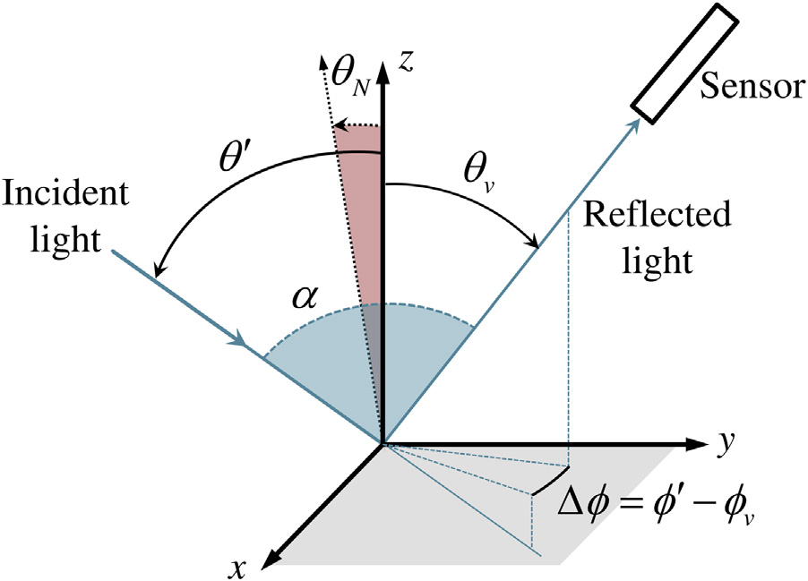
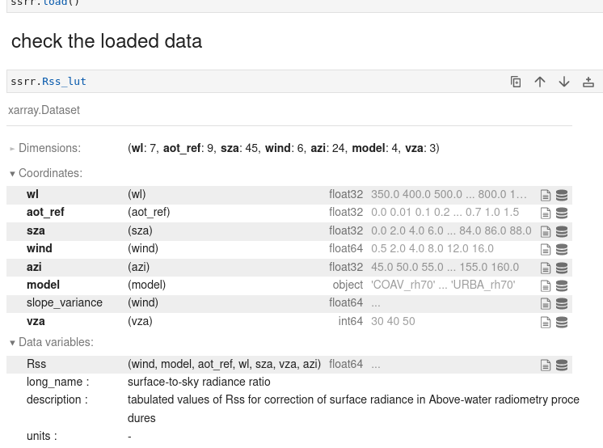
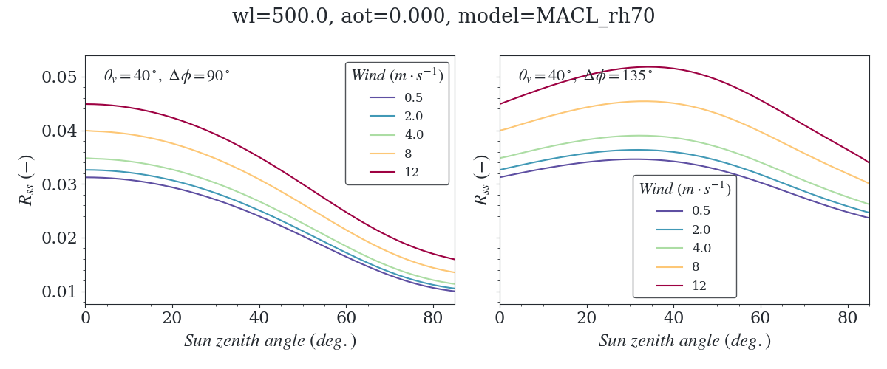

# surface_sky_radiance_ratio
### Minimal code to load and play with tabulated values for surface radiance correction in Above-Water Radiometry procedures

[](https://surface-sky-radiance-ratio.readthedocs.io/en/latest/)
[](https://doi.org/10.3389/frsen.2023.1307976)

This package provides the look-up tables of the surface-to-sky radiance ratio, $R_{ss}$, described in:

> Harmel, T. (2023). Apparent surface-to-sky radiance ratio of natural waters including polarization and aerosol effects: implications for above-water radiometry. *Frontiers in Remote Sensing*, 4, 1307976. [https://doi.org/10.3389/frsen.2023.1307976](https://www.frontiersin.org/journals/remote-sensing/articles/10.3389/frsen.2023.1307976/full)

## Background

In above-water radiometry (AWR), the radiance $L_t$ measured by a sensor pointing down at the water is the sum of the water-leaving radiance $L_w$ and the radiance reflected by the air-water interface $L_{surf}$:

$$
L_t(\theta_s, \theta_v, \Delta\phi, \lambda) = L_w(\theta_s, \theta_v, \Delta\phi, \lambda) + L_{surf}(\theta_s, \theta_v, \Delta\phi, \lambda)
$$

The surface term splits into a diffuse (skylight) component and a direct (sunglint) component:

$$
L_{surf} = L_{surf}^{diff} + L_{surf}^{dir}
$$

The surface-to-sky radiance ratio relates the diffuse surface radiance to the sky radiance $L_{sky}$ measured in the direction that a flat surface would reflect specularly towards the sensor:

$$
R_{ss}(\theta_s, \theta_v, \Delta\phi, \lambda) = \frac{L_{surf}^{diff}(\theta_s, \theta_v, \Delta\phi, \lambda)}{L_{sky}(\theta_s, \pi - \theta_v, \Delta\phi, \lambda)}
$$

$R_{ss}$ replaces the "sea surface reflectance factor" $\rho$ of Mobley (1999). It is a ratio of two radiances, not a true reflectance. Once the sunglint has been removed, the remote sensing reflectance follows as

$$
R_{rs} = \frac{L_t - R_{ss} \, L_{sky}}{E_d}
$$

where $E_d$ is the downwelling irradiance just above the surface.

<p align="center">
    <picture>
        <source media="(prefers-color-scheme: dark)" srcset="illustration/viewing_geometry_dark.png">
        
    </picture>
</p>
<p align="center"><em>Viewing geometry convention: $\theta_v$ and $\phi_v$ are the zenith and azimuth angles of the viewing direction, $\theta'$ and $\phi'$ those of a given illumination direction, $\theta_N$ the zenith angle of the normal to a wave facet and $\alpha$ the phase angle. The relative azimuth $\Delta\phi$ is 0° when the Sun and sensor are in opposition (Fig. 1 of Harmel, 2023, CC BY 4.0).</em></p>

## Look-up tables

$R_{ss}$ was computed with the vector radiative transfer code OSOAA, including polarization, for a Cox-Munk isotropic rough surface and the OPAC aerosol models. The values hold for clear sky conditions and exclude the direct sunglint component. The tables (netCDF, loaded as an `xarray.Dataset`) have the following dimensions:

| Dimension | Description | Values | Units |
|---|---|---|---|
| `wind` | Equivalent Cox-Munk wind speed | 0.5, 2, 4, 8, 12, 16 | m s<sup>-1</sup> |
| `model` | OPAC aerosol model (70% relative humidity) | `COAV_rh70` (continental average), `DESE_rh70` (desert), `MACL_rh70` (maritime clean), `URBA_rh70` (urban) | - |
| `aot_ref` | Aerosol optical thickness at 550 nm | 0 to 1.5 | - |
| `wl` | Wavelength $\lambda$ | 350, 400, 500, 600, 700, 800, 1000; since v1.1 also 1600, 2200, 2500 (atmospheric windows only, see the docs) | nm |
| `sza` | Solar zenith angle $\theta_s$ | 0 to 88, step 2 | degrees |
| `vza` | Viewing zenith angle $\theta_v$ | full table: 0 to 90; sliced table: 30, 40, 50 | degrees |
| `azi` | Relative azimuth $\Delta\phi$ | full table: 0 to 360, step 5; sliced table: 45 to 160, step 5 | degrees |

<p align="center">
    
</p>

## Installation

Python >= 3.10 is required.

```
pip install git+https://github.com/Tristanovsk/surface_sky_radiance_ratio.git
```

or, to run the notebooks, clone the repository and install it with `pip install ".[notebook]"` (`pip install -e ".[all]"` for development).

A reduced size look-up table (view zenith angles 30, 40 and 50°) is installed with the package.
For the full simulations, download the complete netCDF file (v1.1, 350-2500 nm, about 1.2 GB; or v1.0, 350-1000 nm, accessible [here](https://drive.google.com/file/d/1rJ9RkGhNj3jEk3qmS6oGV8VdZaRzL5bO/view?usp=sharing)), place it in the `data` folder of the repository or in a folder given by the environment variable `SURFACE_SKY_RADIANCE_RATIO_DATA`, then load it with `lut('full')`.

## Usage

```python
import matplotlib.pyplot as plt
from surface_sky_radiance_ratio import lut

rss = lut()
rss.load()

# Rss for a maritime aerosol, 4 m/s wind, sun at 30°, sensor at 40° and 135° azimuth
rss.Rss_lut.Rss.sel(model='MACL_rh70', vza=40, azi=135).interp(wind=4, aot_ref=0.1, sza=30, wl=550)

fig, ax = plt.subplots(1, 1)
rss.plot_vs_sza(ax=ax, vza=40, azi=135, wl=500, model='MACL_rh70')
```

Once the installation is successful, you can check the notebooks for practical examples:

<p align="center">
    <picture>
        <source media="(prefers-color-scheme: dark)" srcset="illustration/Rss_Rayleigh_500nm_vza40_dark.png">
        
    </picture>
</p>

## Documentation

The full documentation, including the API reference, is built from the `docs` folder with Sphinx and hosted on [Read the Docs](https://surface-sky-radiance-ratio.readthedocs.io/).
