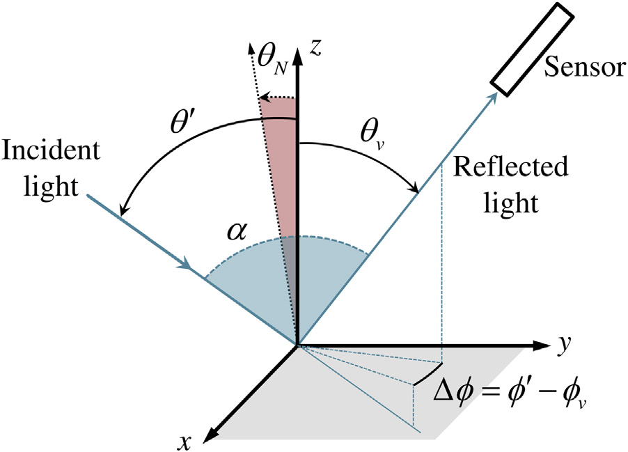

Theory
======

.. automodule:: surface_sky_radiance_ratio.main
   :no-members:
   :no-index:

   Viewing geometry convention: :math:`\theta_v` and :math:`\phi_v` are the
   zenith and azimuth angles of the viewing direction, :math:`\theta'` and
   :math:`\phi'` those of a given illumination direction, :math:`\theta_N` the
   zenith angle of the normal to a wave facet and :math:`\alpha` the phase
   angle (Fig. 1 of Harmel, 2023, CC BY 4.0).

   Viewing geometry convention: :math:`\theta_v` and :math:`\phi_v` are the
   zenith and azimuth angles of the viewing direction, :math:`\theta'` and
   :math:`\phi'` those of a given illumination direction, :math:`\theta_N` the
   zenith angle of the normal to a wave facet and :math:`\alpha` the phase
   angle (Fig. 1 of Harmel, 2023, CC BY 4.0).
